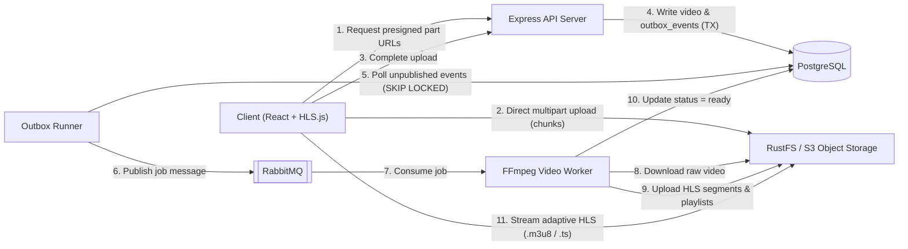

# Video Streaming App

A video streaming platform with a TypeScript/Express API and a React client. The server supports cookie-based authentication, multipart video uploads to S3-compatible RustFS storage, asynchronous video processing, and video playback/download APIs.

## System architecture



## Repository layout

- [`server/`](server/README.md) — Express API, background workers, and OpenAPI documentation.
- [`client/`](client/README.md) — React + TypeScript web client.
- `docker-compose.dev.yml` — local infrastructure services: PostgreSQL, Redis, RabbitMQ, and RustFS.

## Prerequisites

- Node.js 20 or later and npm.
- Docker and Docker Compose for local infrastructure.
- FFmpeg and ffprobe on `PATH` to process videos when running the worker locally.

## Local setup

1. Create a root `.env` file. Keep credentials private and do not commit this file. Configure the variables listed in [Server configuration](server/README.md#configuration).
2. The development Compose file uses an external Docker volume named `pgdata`. Create it once if needed, then start the infrastructure:

   ```powershell
   docker volume create pgdata
   docker compose -f docker-compose.dev.yml up -d
   ```

3. Initialize the PostgreSQL schema. SQL migrations/schema setup are not included in this repository.
4. Create the configured RustFS bucket using the RustFS console at `http://localhost:9001`.
5. In separate terminals, start the API, outbox runner, video worker, and client as described in [`server/README.md`](server/README.md) and [`client/README.md`](client/README.md).

The default client API URL is `http://localhost:5000/api/v1`; configure `PORT=5000` and `API_VERSION=v1` for the server, or set `VITE_API_URL` to match your API address.

## API documentation

When the server is running, Swagger UI is available at [http://localhost:5000/api-docs](http://localhost:5000/api-docs).
